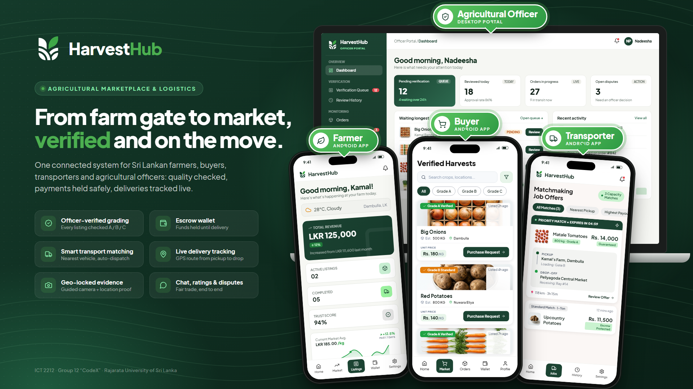
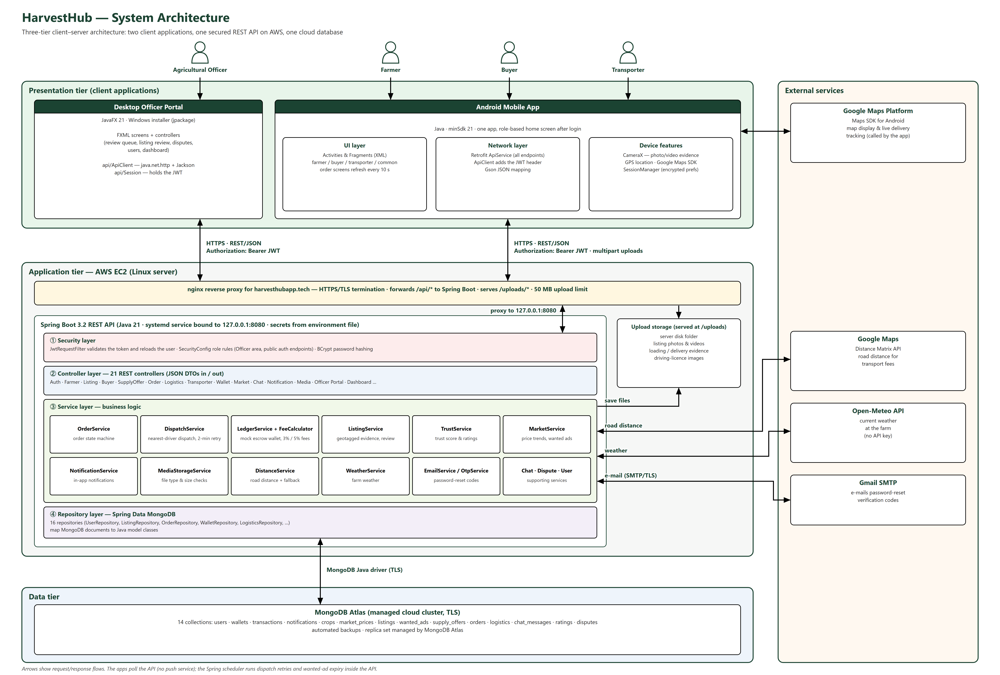
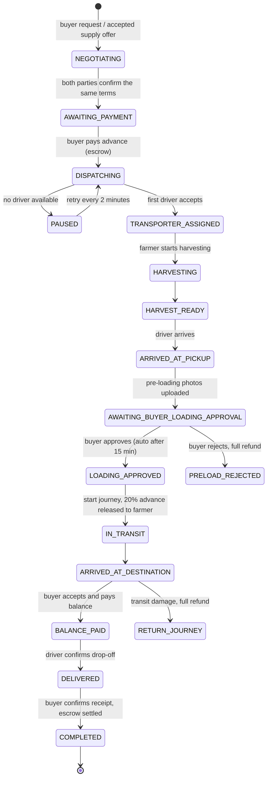

<p align="center">
  
</p>

<h1 align="center">HarvestHub</h1>
<p align="center"><b>Integrated Agricultural Marketplace and Logistics Management System</b></p>

<p align="center">
  
  
  
  
  
  
</p>

<p align="center">
  ICT 2212 Project · Group 12 <b>CodeX</b> · Department of ICT, Faculty of Technology, Rajarata University of Sri Lanka
</p>

---

## Table of contents

1. [Overview](#overview)
2. [Problem and solution](#problem-and-solution)
3. [Key features](#key-features)
4. [System architecture](#system-architecture)
5. [Database design](#database-design)
6. [Order workflow](#order-workflow)
7. [Business rules](#business-rules)
8. [Technology stack](#technology-stack)
9. [Repository structure](#repository-structure)
10. [Installation guide](#installation-guide)
11. [Configuration reference](#configuration-reference)
12. [Running the tests](#running-the-tests)
13. [Deployment](#deployment)
14. [Security](#security)
15. [Team](#team)

---

## Overview

HarvestHub is a digital platform that connects **farmers**, **buyers**, **transporters** and **Agricultural Officers**
in the North Central Province of Sri Lanka. Farmers sell directly to buyers without middlemen. Agricultural Officers
check crop quality before a listing goes live, and the platform handles transport, payments and delivery confirmation
in one flow.

The system has three applications that share one secured REST API and one cloud database:

| Application | Users | Platform |
|---|---|---|
| **Mobile app** | Farmer, Buyer, Transporter | Android (Java, XML layouts) |
| **Officer portal** | Agricultural Officer | Desktop (JavaFX, Windows installer) |
| **REST API** | Used by both clients | Spring Boot on AWS EC2, `https://harvesthubapp.tech` |

## Problem and solution

| Problem | How HarvestHub solves it |
|---|---|
| **Information gap**: farmers don't know what buyers need | A **bidirectional marketplace**. Farmers post listings, buyers post *wanted ads*, and farmers answer them with supply offers. Market price trends help with planning. |
| **Trust gap**: city buyers can't check the quality of crops from remote farms | **Location-locked, geotagged evidence**. Listing photos and video can only be taken in the app at the registered farm. An Agricultural Officer reviews them and grades the listing A, B or C before it is published. |
| **Logistics**: transport is hard to find and price | **Automatic dispatch**. The system picks a vehicle class by weight, calculates the fee from road distance, and offers the job to the nearest available drivers. |
| **Payment risk**: farmers harvest without a commitment, buyers pay without a guarantee | **Payment-first escrow**. The buyer pays an advance before harvesting starts. Funds are held in a mock wallet and released only after the pre-loading check and the two-way delivery confirmation. |

## Key features

**Farmer (Android)**
- Registration with farm location pinned on a map, and login with JWT
- Location lock: a listing can only be created at the registered farm
- Guided in-app camera (wide photo, close-up photo, 10-second video) with GPS and time stamps
- Listing status tracking (pending review, approved with grade, retake requested, rejected)
- Answering buyers' wanted ads with supply offers, and in-app negotiation chat
- Order tracker from harvesting to delivery, wallet, ratings and market insights

**Buyer (Android)**
- Marketplace of officer-verified listings with filters (crop, grade, district, price, quantity)
- Wanted ads (demand requests) and the offers received on them
- Negotiation chat with a binding contract card, and a quote with an automatic transport fee
- Simulated checkout (card or wallet) for the advance and balance payments
- Pre-loading photo approval, live delivery tracking on a map, and delivery handshake
- Disputes, refunds, ratings and wallet history

**Transporter (Android)**
- Vehicle profile (class, body type, licence) and an online/offline switch
- Job requests from dispatch, each with a countdown
- Pickup navigation, pre-loading evidence camera, background GPS during the trip
- Destination arrival, two-way handshake, earnings wallet, job history and appeals

**Agricultural Officer (Desktop)**
- Shared review queue with atomic claim / release
- Listing review with photo and video viewer, GPS and capture-time checks, grading
- Review history, dispute resolution, user management (suspend / reinstate)
- Dashboard with live statistics and recent activity

## System architecture

HarvestHub uses a **three-tier client–server architecture**. The clients never access the database directly. Every
request goes through the REST API, which applies authentication, role rules and business rules in one place.

<p align="center">
  
</p>

- **Presentation tier:** the Android app (UI, Retrofit network layer, CameraX, GPS, maps) and the JavaFX officer
  portal (`java.net.http` + Jackson).
- **Application tier:** nginx terminates HTTPS and forwards requests to the Spring Boot API, which runs as a systemd
  service on `127.0.0.1:8080`. The API is organised in four layers:
  1. Security (JWT filter and role rules)
  2. Controllers (21 REST controllers, JSON DTOs)
  3. Services (order state machine, dispatch, escrow ledger, trust score, market trends, media checks)
  4. Repositories (Spring Data MongoDB)
- **Data tier:** MongoDB Atlas, a managed cloud cluster with TLS, replication and backups. Uploaded media is stored on
  the server disk and served from `/uploads`.
- **External services:** Google Maps (Distance Matrix and Maps SDK), Open-Meteo (farm weather), Gmail SMTP
  (password-reset codes).

## Database design

The data was modelled as an **Enhanced ER (EER) model**, normalised to **3NF**, and then mapped to MongoDB
collections:

- Each strong entity is a collection.
- Relationships are stored as `_id` references.
- Weak entities are embedded arrays.

<p align="center">
  
</p>

| Group | Collections |
|---|---|
| Users and money | `users` (role: FARMER / BUYER / TRANSPORTER / OFFICER), `wallets`, `transactions`, `notifications` |
| Catalogue and market | `crops`, `market_prices`, `listings` (embedded review log) |
| Trading | `wanted_ads`, `supply_offers`, `orders` (embedded status history) |
| Logistics and trust | `logistics` (embedded GPS track points), `chat_messages`, `ratings`, `disputes` |

**Specialisation:** USER is specialised by `role` (disjoint and total), and all roles are stored in one `users`
collection.

**Integrity:** MongoDB has no foreign keys, so the service layer checks that every referenced document exists before
saving. Unique indexes cover:

- each user's email, mobile number and NIC
- one wallet per user
- one logistics record per order
- one rating per party per order
- one market price per crop, centre and date

## Order workflow

Order status changes only through named actions in the `OrderService` state machine. Each action is accepted only
from the correct party and only at the correct step. Clients cannot set a status directly.



## Business rules

| Rule | Value |
|---|---|
| Payments | Mock wallet and simulated card only (no real payment gateway) |
| Buyer platform fee | 3% of (crop value + transport fee) |
| Transporter commission | 5% of the transport fee |
| Farmer fee | 0% |
| Advance | 20% of crop value + transport fee + buyer fee, held in escrow |
| Balance | Remaining 80% of crop value, paid on delivery |
| Refund on rejection | 100%, including the platform fee |
| Transport fee | `distance × rate per km + weight × Rs. 2` |
| Distance | Google Maps road distance, with a Haversine × 1.3 fallback |
| Trust score | `100 × (0.50 × rating/5 + 0.35 × reliability + 0.15 × min(1, completed/20))` |

| Vehicle class | Capacity | Rate per km |
|---|---|---|
| Three-wheeler | 500 kg | Rs. 80 |
| Mini lorry | 1,000 kg | Rs. 120 |
| Lorry | 4,000 kg | Rs. 200 |
| Truck | 10,000 kg | Rs. 350 |

## Technology stack

| Layer | Technologies |
|---|---|
| Back end | Java 21, Spring Boot 3.2.1 (Web, Data MongoDB, Security, Validation, Mail), JJWT 0.11.5, Lombok, Maven |
| Desktop | JavaFX 21.0.6 (FXML, CSS, Media), Ikonli, Jackson, `java.net.http`, jpackage |
| Mobile | Android (Java 8 source, compileSdk 34, minSdk 21), Retrofit 2.9, CameraX 1.3, Google Maps SDK, osmdroid, MPAndroidChart, AndroidX Security Crypto, Gradle 8.14 / AGP 8.13 |
| Database | MongoDB Atlas |
| Infrastructure | AWS EC2 (Linux), nginx, Let's Encrypt, systemd |
| Tools | Git and GitHub, Figma, Postman, IntelliJ IDEA, Android Studio, MongoDB Compass |

## Repository structure

```text
HarvestHub/
├── harvesthub-backend/        Spring Boot REST API
│   └── src/main/java/com/harvesthub/backend/
│       ├── config/            security, CORS, schedulers, marketplace rules, seeders
│       ├── controller/        REST controllers
│       ├── dto/               request / response objects
│       ├── exception/         global error handling
│       ├── model/             MongoDB documents
│       ├── repository/        Spring Data repositories
│       ├── security/          JWT filter, current-user helper
│       ├── service/           business logic (orders, dispatch, ledger, trust, media, ...)
│       └── util/
├── harvesthub-desktop/        JavaFX Agricultural Officer portal
│   └── src/main/java/com/harvesthub/desktop/
│       ├── api/               HTTP client and session
│       ├── pages/             portal pages
│       ├── ui/                shared UI components
│       └── util/
├── harvesthub-android/        Android app for farmers, buyers and transporters
│   └── app/src/main/java/com/harvesthub/mobile/
│       ├── network/           Retrofit ApiService and ApiClient
│       ├── model/             API models
│       ├── ui/                farmer / buyer / transporter / common screens
│       └── utils/             session manager and helpers
├── mongo-init/                MongoDB structure and seed script with sample data
├── scripts/                   run scripts and deployment scripts
├── website/                   public landing page (harvesthubapp.tech)
└── docs/images/               images used in this README
```

## Installation guide

### Prerequisites

| Tool | Version | Needed for |
|---|---|---|
| JDK | 21 or newer | Back end and desktop portal |
| MongoDB | 7+ locally, or a MongoDB Atlas cluster | Back end |
| Android SDK | Platform 34 and platform-tools (`adb`) | Android app |
| Android phone or emulator | Android 5.0 (API 21) or newer | Android app |
| Git | any recent version | Cloning |

Maven and Gradle do not need to be installed. Each project includes its own wrapper (`mvnw`, `gradlew`).

### 1. Clone the repository

```bash
git clone https://github.com/darshana-wishwajith/HarvestHub.git
cd HarvestHub
```

### 2. Set up the database

**Option A: local MongoDB.** Start MongoDB on `localhost:27017`. The API creates the collections and indexes on first
start.

**Option B: MongoDB Atlas.** Create a cluster and a database user, allow your IP address, and copy the
`mongodb+srv://` connection string.

**Optional sample data:**

```bash
mongosh "<your connection string>" mongo-init/seed_harvesthub_database.js
```

### 3. Configure and run the back end

```bash
cd harvesthub-backend
cp application-local.properties.example application-local.properties
```

Edit `application-local.properties` (this file is git-ignored):

```properties
MONGODB_URI=mongodb://localhost:27017/harvesthub_dev
MONGODB_DATABASE=harvesthub_dev
JWT_SECRET=<random string of at least 32 bytes>
MAIL_USERNAME=<gmail address, optional>
MAIL_PASSWORD=<gmail app password, optional>
GOOGLE_MAPS_API_KEY=<optional; Haversine fallback is used without it>
SEED_DEMO_DATA=true
DEMO_PASSWORD=<password for the demo accounts>
```

Start the API on port 8080:

```bash
./mvnw spring-boot:run          # Windows: mvnw.cmd spring-boot:run
```

Or, on Windows, from the repository root:

```powershell
powershell -File scripts\run-backend.ps1
```

When `SEED_DEMO_DATA=true`, the API creates these demo accounts, all using `DEMO_PASSWORD`:
`farmer@harvesthub.lk`, `buyer@harvesthub.lk`, `transporter@harvesthub.lk` and `officer@harvesthub.lk`.
Existing users are never changed.

### 4. Run the desktop officer portal

```bash
cd harvesthub-desktop
HARVESTHUB_BACKEND_URL=http://localhost:8080 ./mvnw javafx:run
```

On Windows:

```powershell
powershell -File scripts\run-desktop.ps1              # local API
powershell -File scripts\run-desktop.ps1 -Production  # https://harvesthubapp.tech
```

To build a Windows app image with its own Java runtime:

```bash
./mvnw clean javafx:jlink
jpackage --type app-image --runtime-image target/harvesthub-app \
  --module com.harvesthub.desktop/com.harvesthub.desktop.PortalApp \
  --name HarvestHub --icon packaging/HarvestHub.ico --dest target/pkg
```

### 5. Build and run the Android app

1. Create `harvesthub-android/local.properties` (git-ignored):

   ```properties
   sdk.dir=C:\\Users\\<you>\\AppData\\Local\\Android\\Sdk
   MAPS_API_KEY=<Google Maps SDK for Android key>
   API_URL=http://<your computer's Wi-Fi IP>:8080/
   ```

2. Connect a phone with USB debugging enabled. Then build, install and launch the app:

   ```powershell
   powershell -File scripts\run-mobile.ps1               # local API on this computer
   powershell -File scripts\run-mobile.ps1 -Production   # https://harvesthubapp.tech
   ```

   Or build manually:

   ```bash
   cd harvesthub-android
   ./gradlew assembleDebug -PapiUrl=http://<your IP>:8080/
   adb install -r app/build/outputs/apk/debug/app-debug.apk
   ```

Debug builds allow plain HTTP so they can reach a local API. Release builds use HTTPS only and connect to production.

## Configuration reference

The back end reads every setting from environment variables, or from `application-local.properties` during
development. No secrets are stored in the repository.

| Variable | Required | Default | Purpose |
|---|---|---|---|
| `MONGODB_URI` | yes | `mongodb://localhost:27017/harvesthub` | Database connection string |
| `MONGODB_DATABASE` | no | `harvesthub` | Database name |
| `JWT_SECRET` | yes | none | Token signing key (at least 32 bytes) |
| `JWT_EXPIRATION_MS` | no | `86400000` | Token lifetime (24 h) |
| `MAIL_HOST`, `MAIL_PORT` | no | `smtp.gmail.com`, `587` | SMTP server for password-reset codes |
| `MAIL_USERNAME`, `MAIL_PASSWORD` | no | empty | SMTP credentials |
| `GOOGLE_MAPS_API_KEY` | no | empty | Road distance (Distance Matrix) |
| `UPLOAD_DIR` | no | `uploads` | Folder for uploaded photos and videos |
| `SEED_DEMO_DATA` | no | `false` | Create demo accounts on start-up |
| `DEMO_PASSWORD` | with seeding | empty | Password for the demo accounts |

## Running the tests

```bash
cd harvesthub-backend && ./mvnw test                 # unit + integration tests (local test database)
cd harvesthub-desktop && ./mvnw test                 # portal unit tests
cd harvesthub-android && ./gradlew testDebugUnitTest # app unit tests
```

Back-end integration tests use their own configuration in `src/test/resources` and a local MongoDB database. They
never write to the production database.

## Deployment

Production runs on an AWS EC2 Linux server behind nginx with a Let's Encrypt certificate.

1. **Prepare the server (one time).** Copy `scripts/deploy/server-setup.sh` to the server and run:

   ```bash
   sudo bash server-setup.sh harvesthubapp.tech <email>
   ```

   This installs Java 21, nginx and certbot, and creates the `harvesthub` systemd service and the environment file
   `/etc/harvesthub/harvesthub.env`. Fill in the secrets in that file.
2. **Deploy a new version.** From the repository root:

   ```powershell
   powershell -File scripts\deploy\deploy-backend.ps1 -HostName <server IP> -KeyPath <path to SSH key>
   ```

   The script builds the JAR, backs up the current one on the server, uploads the new one and restarts the service.
   Keep the SSH key outside the repository.

The public landing page in `website/` is served by the same nginx instance.

## Security

- **Authentication:** stateless JWT. The token subject is the user id, and the user is reloaded on every request, so
  a suspended account loses access immediately.
- **Passwords:** stored only as BCrypt hashes. Password-reset codes are also stored as hashes and expire.
- **Access control:** role-based for FARMER, BUYER, TRANSPORTER and OFFICER. The acting user always comes from the
  token, never from the request body.
- **Responses:** the API returns DTOs only. Password hashes and reset tokens are never sent.
- **Uploads:** file type is checked by magic bytes, sizes are limited, and file names are generated by the server.
- **Secrets:** read from environment variables. `.gitignore` excludes keys, local configuration, uploads and backups.

## Team

**Group 12 · CodeX**, Bachelor of Information and Communication Technology, Rajarata University of Sri Lanka

| Name | Index number |
|---|---|
| W.B.D.W. Bandara | 2452 |
| L.V.L.S. Jayarathne | 2451 |
| U.H.G.R. Madushan | 2354 |
| H.H.D.V. Ishan | 2353 |
| R.A. Kavindi | 2450 |
| H.W.D.I. Ishanthi | 2362 |

**Supervisor:** Ms. Dinusika Wickramasiri, Department of Information and Communication Technology

---

<p align="center">Developed for the ICT 2212 Project module, Rajarata University of Sri Lanka, 2026.</p>
